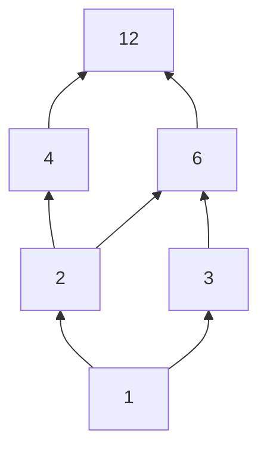

# Cours – Produit cartésien, relations binaires et applications

*BTS SIO SISR 1re année – Mathématiques pour l'informatique – S11 – à lire avant les [exercices](02-exercices.md)*

> [!NOTE] Ce que tu dois savoir déjà
> - **Prérequis :** S09 (ensembles).
> - **Outils :** Papier, calculatrice, éditeur Python intégré au site

## À la fin de ce cours tu sauras

- [ ] **Définir** le produit cartésien et **calculer** son cardinal ;
- [ ] **Étudier** une relation binaire (réflexive, symétrique, antisymétrique, transitive) ;
- [ ] **Reconnaître** une relation d'équivalence et **décrire** ses classes ; **reconnaître** une relation d'ordre ;
- [ ] **Distinguer** application, injection, surjection, bijection, et **composer** des applications ;
- [ ] **Déterminer** une image directe et une image réciproque.

## I. Produit cartésien

Le **produit cartésien** de deux ensembles \(A\) et \(B\) est l'ensemble des **couples** \((a, b)\) avec \(a \in A\) et \(b \in B\) :

\[
A \times B = \{(a, b) \mid a \in A,\ b \in B\}
\]

Un couple est **ordonné** : \((a, b) \neq (b, a)\) en général. Le cardinal du produit est \(\lvert A \times B \rvert = \lvert A \rvert \cdot \lvert B \rvert\).

**Exemple.** Avec \(A = \{1, 2, 3\}\) et \(B = \{x, y\}\) :

\[
A \times B = \{(1, 'x'), (1, 'y'), (2, 'x'), (2, 'y'), (3, 'x'), (3, 'y')\}
\]

soit \(3 \times 2 = 6\) couples. Avec trois protocoles et quatre ports, il y a \(3 \times 4 = 12\) couples (protocole, port) à décrire dans une règle de pare-feu.

On écrit \(A^2\) pour \(A \times A\), et \(A^n\) pour les \(n\)-uplets.

## II. Relations binaires

Une **relation binaire** \(\mathcal{R}\) de \(A\) vers \(B\) est une partie de \(A \times B\). On écrit \(x\,\mathcal{R}\,y\) pour \((x, y) \in \mathcal{R}\). Quand \(A = B = E\), on parle de relation **sur \(E\)**.

**Exemple.** Sur \(E = \{1, 2, 3, 4, 6, 12\}\), la relation « \(x\) divise \(y\) » contient les couples \{(1, 1), (1, 2), (1, 3), (1, 4), (1, 6), (1, 12), (2, 2), (2, 4), (2, 6), (2, 12), (3, 3), (3, 6), (3, 12), (4, 4), (4, 12), (6, 6), (6, 12), (12, 12)\}.

Une relation sur un ensemble fini se représente par une **table** (1 si \(x\,\mathcal{R}\,y\)) :

| | 1 | 2 | 3 | 4 |
|---|---|---|---|---|
| **1** | 1 | 1 | 1 | 1 |
| **2** | 0 | 1 | 0 | 1 |
| **3** | 0 | 0 | 1 | 0 |
| **4** | 0 | 0 | 0 | 1 |

(« \(x\) divise \(y\) » sur \(\{1,2,3,4\}\) ; la ligne est \(x\), la colonne \(y\).)

## III. Propriétés d'une relation sur \(E\)

| Propriété | En mots | Avec quantificateurs |
|---|---|---|
| **Réflexive** | Tout élément est en relation avec lui-même | \(\forall x \in E,\ x\,\mathcal{R}\,x\) |
| **Symétrique** | Si \(x\) est lié à \(y\), alors \(y\) est lié à \(x\) | \(\forall x, y,\ x\,\mathcal{R}\,y \Rightarrow y\,\mathcal{R}\,x\) |
| **Antisymétrique** | Si \(x\) est lié à \(y\) et \(y\) à \(x\), c'est le même élément | \(\forall x, y,\ (x\,\mathcal{R}\,y \wedge y\,\mathcal{R}\,x) \Rightarrow x = y\) |
| **Transitive** | Si \(x\) est lié à \(y\) et \(y\) à \(z\), alors \(x\) est lié à \(z\) | \(\forall x, y, z,\ (x\,\mathcal{R}\,y \wedge y\,\mathcal{R}\,z) \Rightarrow x\,\mathcal{R}\,z\) |

> [!WARNING]
> **Symétrique et antisymétrique ne sont pas contraires.** La relation d'égalité est les deux à la fois ; une relation peut n'être ni l'une ni l'autre. Pour **réfuter** une propriété, il suffit d'un contre-exemple.

Sur \(E = \{1, 2, 3, 4, 5, 6\}\) (résultats calculés couple par couple) :

| Relation | Réflexive | Symétrique | Antisymétrique | Transitive | Nature |
|---|---|---|---|---|---|
| \(x \le y\) | oui | non | oui | oui | ordre |
| \(x < y\) | non | non | oui | oui | — |
| \(x\) divise \(y\) | oui | non | oui | oui | ordre |
| \(x \equiv y \pmod 2\) | oui | oui | non | oui | équivalence |
| \(x + y = 7\) | non | oui | non | non | — |
| \(x \neq y\) | non | oui | non | non | — |

Remarque : \(x < y\) est antisymétrique « à vide » (aucun couple \((x, y)\) et \((y, x)\) avec \(x \neq y\) n'existe en même temps) ; \(x + y = 7\) n'est pas transitive car \(1 + 6 = 7\) et \(6 + 1 = 7\) mais \(1 + 1 \neq 7\).

## IV. Relation d'équivalence

Une relation est une **relation d'équivalence** si elle est **réflexive, symétrique et transitive**. Elle regroupe les éléments « semblables » en **classes**.

La **classe** d'un élément \(x\) est \([x] = \{y \in E \mid x\,\mathcal{R}\,y\}\). Deux propriétés fondamentales :

- deux classes sont **égales ou disjointes** ;
- toutes les classes **recouvrent** \(E\) : elles forment une **partition** de \(E\).

**Exemple.** « \(x \equiv y \pmod 2\) » sur \(\{1, \dots, 6\}\) est une équivalence (S07). Ses classes : \(\{1, 3, 5\}\) et \(\{2, 4, 6\}\) — les impairs et les pairs.

**Autre exemple.** Sur \(\{0, \dots, 8\}\), « \(x \equiv y \pmod 3\) » : \(\{0, 3, 6\}\) ; \(\{1, 4, 7\}\) ; \(\{2, 5, 8\}\). Trois classes de 3 éléments chacune.

> [!NOTE]
> **En réseau.** « Deux machines sont dans le même sous-réseau » (même adresse ET masque, annexe de S10) est une relation d'équivalence : ses classes sont les sous-réseaux.

## V. Relation d'ordre

Une relation est une **relation d'ordre** si elle est **réflexive, antisymétrique et transitive**. L'ordre est **total** si deux éléments quelconques sont toujours comparables, **partiel** sinon.

- \(\le\) sur les entiers : ordre **total**.
- « divise » sur \(\{1, 2, 3, 4, 6, 12\}\) : ordre **partiel** (2 ne divise pas 3 et 3 ne divise pas 2).

On représente un ordre fini par son **diagramme de Hasse** : on ne trace que les liens de « couverture » (sans les liens déduits par transitivité ni les boucles), le plus petit en bas.

Les arêtes (calculées) sont : 1→2, 1→3, 2→4, 2→6, 3→6, 4→12, 6→12. Ici 1 est le **plus petit élément** et 12 le **plus grand**. En informatique : ordre des tâches d'un projet (S17), version d'un logiciel, droits hiérarchisés.

## VI. Applications

Une **application** \(f\) de \(A\) dans \(B\) associe à **chaque** élément \(x\) de \(A\) **un seul** élément \(f(x)\) de \(B\). On note \(f : A \to B\). L'élément \(f(x)\) est l'**image** de \(x\) ; \(x\) est un **antécédent** de \(f(x)\).

> [!WARNING]
> Une relation n'est une application que si **tout** élément de \(A\) a **exactement une** image. Si un élément n'a aucune image, ou en a deux, ce n'est pas une application.

### Injective, surjective, bijective

| Propriété | Définition | En clair | Test sur un tableau |
|---|---|---|---|
| **Injective** | \(f(x) = f(x') \Rightarrow x = x'\) | deux éléments distincts ont des images distinctes | aucune image n'apparaît deux fois |
| **Surjective** | tout \(y \in B\) a au moins un antécédent | tout élément de \(B\) est atteint | toutes les valeurs de \(B\) apparaissent |
| **Bijective** | injective **et** surjective | chaque \(y\) a **exactement un** antécédent | les deux tests |

**Exemple.** \(f : \{0,\dots,9\} \to \{0,\dots,4\}\), \(f(x) = x \bmod 5\) :

| \(x\) | 0 | 1 | 2 | 3 | 4 | 5 | 6 | 7 | 8 | 9 |
|---|---|---|---|---|---|---|---|---|---|---|
| \(f(x)\) | 0 | 1 | 2 | 3 | 4 | 0 | 1 | 2 | 3 | 4 |

\(f\) est surjective : tout élément de \(\{0,\dots,4\}\) est atteint, mais 0 a deux antécédents (0 et 5). C'est le principe des **collisions** d'une fonction de hachage : si l'on range 10 éléments dans 5 cases, au moins une case en reçoit deux.

> [!NOTE]
> **Cas des ensembles finis.** Si \(\lvert A \rvert = \lvert B \rvert\), alors injective \(\Leftrightarrow\) surjective \(\Leftrightarrow\) bijective. Si \(\lvert A \rvert > \lvert B \rvert\), une application ne peut pas être injective (principe des tiroirs).

**Exemples sur les nombres** (le résultat dépend des ensembles de départ et d'arrivée) :

| Application | Injective | Surjective | Bijective |
|---|---|---|---|
| \(\mathbb{R} \to \mathbb{R},\ x \mapsto 2x + 1\) | oui | oui | oui |
| \(\mathbb{Z} \to \mathbb{Z},\ n \mapsto 2n\) | oui | non (les impairs ne sont pas atteints) | non |
| \(\mathbb{R} \to \mathbb{R},\ x \mapsto x^2\) | non (\(f(2) = f(-2)\)) | non (\(-1\) n'est pas atteint) | non |
| \(\mathbb{R}_+ \to \mathbb{R}_+,\ x \mapsto x^2\) | oui | oui | oui |

### Application réciproque et composée

Si \(f : A \to B\) est **bijective**, elle a une **réciproque** \(f^{-1} : B \to A\) qui à \(y\) associe son unique antécédent. Pour \(f(x) = 2x + 1\) : \(y = 2x + 1 \iff x = \dfrac{y - 1}{2}\), donc \(f^{-1}(y) = \dfrac{y - 1}{2}\).

La **composée** de \(f : A \to B\) et \(g : B \to C\) est \(g \circ f : A \to C\), \(x \mapsto g(f(x))\) : on applique \(f\) **d'abord**. L'ordre compte. Avec \(f(x) = 2x + 1\) et \(g(x) = x^2\) : \((g \circ f)(x) = (2x + 1)^2\) et \((f \circ g)(x) = 2x^2 + 1\) ; pour \(x = 3\), \((g \circ f)(3) = 49\) et \((f \circ g)(3) = 19\).

### Image directe et image réciproque

Pour \(X \subseteq A\) et \(Y \subseteq B\) :

\[
f(X) = \{f(x) \mid x \in X\} \qquad f^{-1}(Y) = \{x \in A \mid f(x) \in Y\}
\]

Avec \(f(x) = x \bmod 5\) sur \(\{0,\dots,9\}\) : \(f(\{0,1,2,3\}) = \{0, 1, 2, 3\}\), \(f^{-1}(\{0\}) = \{0, 5\}\), \(f^{-1}(\{1,2\}) = \{1, 2, 6, 7\}\).

> [!WARNING]
> \(f^{-1}(Y)\) (image **réciproque** d'une partie) existe **toujours**, même si \(f\) n'est pas bijective ; la **fonction** réciproque \(f^{-1}\) n'existe que si \(f\) est bijective.

### Combien d'applications ?

De \(A\) (\(p\) éléments) vers \(B\) (\(n\) éléments), il y a \(n^p\) applications : chacun des \(p\) éléments a \(n\) choix. Pour \(p = 3\), \(n = 4\) : \(4^3 = 64\) (dont 24 injections).

## À retenir

- \(\lvert A \times B \rvert = \lvert A \rvert \cdot \lvert B \rvert\) ; un couple est ordonné.
- Propriétés : réflexive, symétrique, antisymétrique, transitive.
- **Équivalence** = réflexive + symétrique + transitive → **classes** qui partitionnent \(E\) ; **ordre** = réflexive + antisymétrique + transitive.
- **Application** : chaque élément de \(A\) a **une et une seule** image. Injective / surjective / bijective.
- \(g \circ f\) : on applique \(f\) puis \(g\). \(f^{-1}\) n'existe que si \(f\) est bijective.
