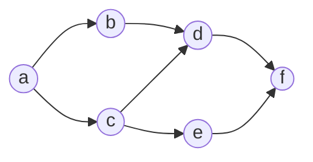
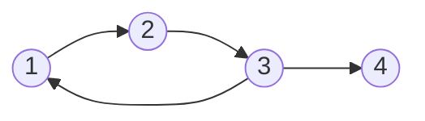
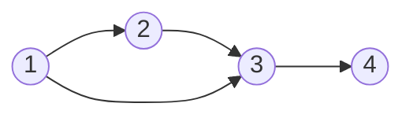

# Cours – Graphes orientés : représentations, chemins et niveaux

*BTS SIO SISR 1re année – Mathématiques pour l'informatique – S16 – à lire avant les [exercices](02-exercices.md)*

> [!NOTE] Ce que tu dois savoir déjà
> - **Prérequis :** S09 (ensembles, relations), S13 (matrices).
> - **Outils :** Papier, calculatrice, éditeur Python intégré au site

## À la fin de ce cours tu sauras

- [ ] **Représenter** un graphe orienté fini simple par un dessin, un tableau de successeurs, une matrice d'adjacence ;
- [ ] **Reconnaître** chemin, circuit, boucle, chemin hamiltonien ;
- [ ] **Interpréter** les puissances de la matrice d'adjacence (nombre de chemins de longueur \(p\)) ;
- [ ] **Calculer** la fermeture transitive avec des produits booléens ;
- [ ] **Déterminer** les niveaux d'un graphe sans circuit.

## I. Graphes orientés

Un **graphe orienté** est un ensemble de **sommets** reliés par des **arcs** (flèches). Un arc \((x, y)\) va de \(x\) vers \(y\). Un graphe est **simple** s'il n'y a pas deux arcs identiques ; un arc \((x, x)\) est une **boucle**. Un arc est un couple : le graphe est donc une **relation** sur l'ensemble des sommets (S11).

**Situation.** Six services s'appuient les uns sur les autres : l'arc \(x \to y\) signifie « \(y\) a besoin de \(x\) ».

| Vocabulaire | Définition | Dans ce graphe |
|---|---|---|
| **Successeur** de \(x\) | sommet \(y\) tel que \(x \to y\) | successeurs de \(c\) : \(d\) et \(e\) |
| **Prédécesseur** de \(y\) | sommet \(x\) tel que \(x \to y\) | prédécesseurs de \(d\) : \(b\) et \(c\) |
| **Demi-degré extérieur** \(d^+(x)\) | nombre d'arcs qui **partent** de \(x\) | \(d^+(a) = 2\) |
| **Demi-degré intérieur** \(d^-(x)\) | nombre d'arcs qui **arrivent** en \(x\) | \(d^-(f) = 2\) |

## II. Trois façons de représenter un graphe

**1. Le dessin** (ci-dessus).

**2. Le tableau des successeurs** (et prédécesseurs) :

| Sommet | Successeurs | Prédécesseurs |
|---|---|---|
| a | b, c | aucun |
| b | d | a |
| c | d, e | a |
| d | f | b, c |
| e | f | c |
| f | aucun | d, e |

**3. La matrice d'adjacence** \(M\) : le coefficient \(m_{ij}\) vaut 1 s'il existe un arc de \(i\) vers \(j\), 0 sinon (sommets pris dans l'ordre \(a, b, c, d, e, f\)).

\[
M = \begin{pmatrix} 0 & 1 & 1 & 0 & 0 & 0 \\ 0 & 0 & 0 & 1 & 0 & 0 \\ 0 & 0 & 0 & 1 & 1 & 0 \\ 0 & 0 & 0 & 0 & 0 & 1 \\ 0 & 0 & 0 & 0 & 0 & 1 \\ 0 & 0 & 0 & 0 & 0 & 0 \end{pmatrix}
\]

La **somme d'une ligne** donne le demi-degré extérieur du sommet ; la **somme d'une colonne** son demi-degré intérieur :

| | a | b | c | d | e | f | Somme (ligne) |
|---|---|---|---|---|---|---|---|
| **a** | 0 | 1 | 1 | 0 | 0 | 0 | 2 |
| **b** | 0 | 0 | 0 | 1 | 0 | 0 | 1 |
| **c** | 0 | 0 | 0 | 1 | 1 | 0 | 2 |
| **d** | 0 | 0 | 0 | 0 | 0 | 1 | 1 |
| **e** | 0 | 0 | 0 | 0 | 0 | 1 | 1 |
| **f** | 0 | 0 | 0 | 0 | 0 | 0 | 0 |
| **Somme (colonne)** | 0 | 1 | 1 | 2 | 1 | 2 | |

Le total (nombre d'arcs) vaut 7, de deux façons : somme des lignes et somme des colonnes.

## III. Chemins et circuits

| Notion | Définition |
|---|---|
| **Chemin** | suite de sommets \(x_0, x_1, \dots, x_p\) où chaque \(x_k \to x_{k+1}\) est un arc |
| **Longueur** | nombre d'arcs du chemin (\(p\)) |
| **Circuit** | chemin de longueur \(\ge 1\) dont le dernier sommet est égal au premier |
| **Boucle** | circuit de longueur 1 |
| **Chemin hamiltonien** | chemin qui passe **une et une seule fois** par chaque sommet |

Dans le graphe des services, \(a \to c \to d \to f\) est un chemin de longueur 3. Il n'y a pas de circuit (on ne revient jamais en arrière).

Voici un graphe **avec circuit** : \(1 \to 2 \to 3 \to 1\) est un circuit de longueur 3.

Et un graphe qui possède un chemin hamiltonien : \(1 \to 2 \to 3 \to 4\) passe une seule fois par chacun des quatre sommets.

Le graphe des services n'a **pas** de chemin hamiltonien (vérifié en essayant les 720 ordres possibles des 6 sommets) : ni \(b\) n'atteint \(c\), ni \(c\) n'atteint \(b\) : un même chemin ne peut pas visiter les deux.

## IV. Puissances de la matrice d'adjacence

> [!NOTE]
> **Propriété.** Le coefficient de la ligne \(i\) et de la colonne \(j\) de \(M^p\) est le **nombre de chemins de longueur \(p\)** allant de \(i\) à \(j\).

Pourquoi ? \((M^2)_{ij} = \sum_k m_{ik}\,m_{kj}\) compte les sommets intermédiaires \(k\) tels que \(i \to k \to j\). Le produit de matrices (S13) enchaîne les arcs.

\[
M^2 = \begin{pmatrix} 0 & 0 & 0 & 2 & 1 & 0 \\ 0 & 0 & 0 & 0 & 0 & 1 \\ 0 & 0 & 0 & 0 & 0 & 2 \\ 0 & 0 & 0 & 0 & 0 & 0 \\ 0 & 0 & 0 & 0 & 0 & 0 \\ 0 & 0 & 0 & 0 & 0 & 0 \end{pmatrix} \qquad M^3 = \begin{pmatrix} 0 & 0 & 0 & 0 & 0 & 3 \\ 0 & 0 & 0 & 0 & 0 & 0 \\ 0 & 0 & 0 & 0 & 0 & 0 \\ 0 & 0 & 0 & 0 & 0 & 0 \\ 0 & 0 & 0 & 0 & 0 & 0 \\ 0 & 0 & 0 & 0 & 0 & 0 \end{pmatrix}
\]

Lecture : \((M^2)_{ad} = 2\) (chemins \(a \to b \to d\) et \(a \to c \to d\)) ; \((M^3)_{af} = 3\) : a → b → d → f ; a → c → d → f ; a → c → e → f.

Comme il n'y a pas de circuit, on ne peut pas allonger indéfiniment un chemin : \(M^4 = \begin{pmatrix} 0 & 0 & 0 & 0 & 0 & 0 \\ 0 & 0 & 0 & 0 & 0 & 0 \\ 0 & 0 & 0 & 0 & 0 & 0 \\ 0 & 0 & 0 & 0 & 0 & 0 \\ 0 & 0 & 0 & 0 & 0 & 0 \\ 0 & 0 & 0 & 0 & 0 & 0 \end{pmatrix}\) est la matrice nulle (le plus long chemin a 3 arcs). Plus généralement, **un graphe à \(n\) sommets sans circuit vérifie \(M^n = 0\)**, et **un graphe avec circuit a toutes ses puissances non nulles** (on peut tourner dans le circuit autant qu'on veut). Pour le graphe à circuit ci-dessus : \(M^k \neq 0\) pour \(k\) de 1 à 24 (vérifié).

## V. Fermeture transitive

La **fermeture transitive** d'un graphe contient un arc \(i \to j\) chaque fois qu'il existe **un chemin** (de longueur \(\ge 1\)) de \(i\) vers \(j\) : elle répond à « qui peut atteindre qui ? ». C'est la plus petite relation transitive contenant le graphe (S11).

Calcul avec des **produits booléens** (\(0 + 0 = 0\), \(1 + 1 = 1\), \(0 \cdot 1 = 0\), c'est-à-dire ET et OU, S10) : on additionne (booléen) \(M, M^{[2]}, \dots, M^{[n-1]}\), où \(M^{[p]}\) est la puissance booléenne.

\[
M^* = \begin{pmatrix} 0 & 1 & 1 & 1 & 1 & 1 \\ 0 & 0 & 0 & 1 & 0 & 1 \\ 0 & 0 & 0 & 1 & 1 & 1 \\ 0 & 0 & 0 & 0 & 0 & 1 \\ 0 & 0 & 0 & 0 & 0 & 1 \\ 0 & 0 & 0 & 0 & 0 & 0 \end{pmatrix}
\]

Lecture : le sommet \(a\) atteint tous les autres (ligne 1 : que des 1 sauf pour \(a\) lui-même) ; \(f\) n'atteint aucun sommet (ligne 6 nulle). Sur cet exemple, le résultat a été contrôlé avec une bibliothèque de graphes.

> [!NOTE]
> Une alternative : calculer les puissances **ordinaires** et remplacer tout coefficient non nul par 1. On obtient le même résultat, avec des nombres plus grands.

## VI. Niveaux d'un graphe sans circuit

Quand il n'y a pas de circuit, on peut ranger les sommets en **niveaux** tels que tout arc aille d'un niveau vers un niveau **supérieur**. C'est l'ordre dans lequel démarrer les services.

**Méthode (à suivre dans les exercices).**

1. Niveau 0 : les sommets **sans prédécesseur** (colonne de zéros dans la matrice).
2. On **supprime** ces sommets (et leurs arcs).
3. On recommence avec le graphe restant : les nouveaux sommets sans prédécesseur forment le niveau suivant.
4. On s'arrête quand tous les sommets sont placés. Si, à un moment, **il reste des sommets mais aucun sans prédécesseur**, il y a un **circuit** : la méthode échoue.

Pour le graphe des services :

| Niveau | Sommets |
|---|---|
| 0 | a |
| 1 | b, c |
| 2 | d, e |
| 3 | f |

On peut donc démarrer \(a\), puis \(b\) et \(c\), puis \(d\) et \(e\), puis \(f\). Les sommets d'un même niveau peuvent démarrer **en parallèle**.

Pour le graphe à circuit (\(1 \to 2 \to 3 \to 1,\ 3 \to 4\)) : tous les sommets ont un prédécesseur (4 a pour prédécesseur 3, et 1, 2, 3 se suivent en cercle) : aucun niveau 0, **impossible**. En pratique, une dépendance circulaire empêche tout démarrage.

## À retenir

- Graphe orienté = sommets + arcs ; matrice d'adjacence \(M\) (\(m_{ij} = 1\) si \(i \to j\)) ; somme d'une ligne = demi-degré extérieur, d'une colonne = intérieur.
- Chemin, longueur, circuit, boucle, chemin hamiltonien (une seule fois par sommet).
- \((M^p)_{ij}\) = nombre de chemins de longueur \(p\) de \(i\) à \(j\) ; sans circuit : \(M^n = 0\).
- Fermeture transitive = « qui atteint qui » (somme booléenne des puissances).
- Niveaux : retirer successivement les sommets sans prédécesseur ; échec = circuit.
