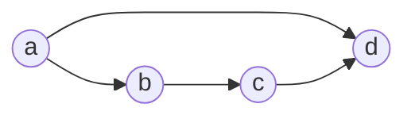

# Exercices – Graphes, matrices d’adjacence et chemins

*BTS SIO SISR 1re année – Mathématiques pour l'informatique – S16*

> [!NOTE]
> **Comment travailler.** Cherche d'abord **sur papier**, avec la méthode du cours : écris les étapes, pas seulement le résultat. Ouvre ensuite « Voir la réponse » pour te corriger. À l'épreuve, **aucune réponse sans justification** n'est complète.

Dans tous les exercices, la méthode à suivre est indiquée.

## Exercice 1 – Lire un graphe

Un graphe a pour sommets 1 à 5 et pour arcs : 1 → 2, 1 → 3, 2 → 4, 3 → 4, 4 → 5, 3 → 5.

1. Dessiner le graphe.
2. Donner le tableau des successeurs et des prédécesseurs.
3. Écrire la matrice d'adjacence et en déduire les demi-degrés (sommes de lignes et de colonnes).

<details markdown="1">
<summary>Voir la réponse</summary>

1. ```mermaid
flowchart LR
    n0((1))
    n1((2))
    n2((3))
    n3((4))
    n4((5))
    n0 --> n1
    n0 --> n2
    n1 --> n3
    n2 --> n3
    n3 --> n4
    n2 --> n4
```
2. | Sommet | Successeurs | Prédécesseurs |
|---|---|---|
| 1 | 2, 3 | aucun |
| 2 | 4 | 1 |
| 3 | 4, 5 | 1 |
| 4 | 5 | 2, 3 |
| 5 | aucun | 3, 4 |
3. \(M = \begin{pmatrix} 0 & 1 & 1 & 0 & 0 \\ 0 & 0 & 0 & 1 & 0 \\ 0 & 0 & 0 & 1 & 1 \\ 0 & 0 & 0 & 0 & 1 \\ 0 & 0 & 0 & 0 & 0 \end{pmatrix}\) ; sommes de lignes (\(d^+\)) : 2, 1, 2, 1, 0 ; sommes de colonnes (\(d^-\)) : 0, 1, 1, 2, 2 ; total 6 arcs.

</details>

## Exercice 2 – Retrouver le graphe

La matrice d'adjacence d'un graphe de sommets \(a, b, c, d\) est \(M = \begin{pmatrix} 0 & 1 & 0 & 1 \\ 0 & 0 & 1 & 0 \\ 0 & 0 & 0 & 1 \\ 0 & 0 & 0 & 0 \end{pmatrix}\). Lister les arcs et dessiner le graphe. Donner un chemin hamiltonien s'il y en a un.

<details markdown="1">
<summary>Voir la réponse</summary>

Arcs (ligne → colonne) : a → b, a → d, b → c, c → d.



Chemin hamiltonien : a → b → c → d (il passe une fois par chaque sommet).

</details>

## Exercice 3 – Vocabulaire

Dans le graphe à circuit du cours (arcs \(1 \to 2\), \(2 \to 3\), \(3 \to 1\), \(3 \to 4\)), répondre : (a) \(1 \to 2 \to 3 \to 4\) est-il un chemin ? sa longueur ? (b) \(1 \to 2 \to 3 \to 1\) est-il un chemin ? un circuit ? (c) Existe-t-il un chemin de 4 vers 1 ? (d) Y a-t-il une boucle ? un chemin hamiltonien ?

<details markdown="1">
<summary>Voir la réponse</summary>

(a) Oui, de longueur 3. (b) Chemin de longueur 3 et circuit (il revient à son point de départ). (c) Non : 4 n'a aucun successeur. (d) Pas de boucle (aucun arc \((x, x)\)) ; oui, un chemin hamiltonien : 1 → 2 → 3 → 4 (vérifié par recherche exhaustive).

</details>

## Exercice 4 – Compter des chemins

On reprend le graphe des services du cours (\(M\) et \(M^2\), \(M^3\) calculées). Sans refaire le calcul, répondre avec les matrices ; puis vérifier en listant les chemins : (a) combien de chemins de longueur 2 de \(a\) vers \(d\) ? (b) de longueur 3 de \(a\) vers \(f\) ? (c) de longueur 2 de \(c\) vers \(f\) ?

<details markdown="1">
<summary>Voir la réponse</summary>

(a) \((M^2)_{ad} = 2\) : a → b → d ; a → c → d.
(b) \((M^3)_{af} = 3\) : a → b → d → f ; a → c → d → f ; a → c → e → f.
(c) \((M^2)_{cf} = 2\) : c → d → f ; c → e → f.

</details>

## Exercice 5 – Calculer une puissance

Un graphe a pour matrice \(M = \begin{pmatrix} 0 & 1 & 0 & 0 \\ 0 & 0 & 1 & 0 \\ 0 & 0 & 0 & 1 \\ 1 & 0 & 0 & 0 \end{pmatrix}\) (sommets 1 à 4). Calculer \(M^2\), \(M^3\), \(M^4\). Que remarque-t-on ? Y a-t-il un circuit ?

<details markdown="1">
<summary>Voir la réponse</summary>

\(M^2 = \begin{pmatrix} 0 & 0 & 1 & 0 \\ 0 & 0 & 0 & 1 \\ 1 & 0 & 0 & 0 \\ 0 & 1 & 0 & 0 \end{pmatrix}\), \(M^3 = \begin{pmatrix} 0 & 0 & 0 & 1 \\ 1 & 0 & 0 & 0 \\ 0 & 1 & 0 & 0 \\ 0 & 0 & 1 & 0 \end{pmatrix}\), \(M^4 = \begin{pmatrix} 1 & 0 & 0 & 0 \\ 0 & 1 & 0 & 0 \\ 0 & 0 & 1 & 0 \\ 0 & 0 & 0 & 1 \end{pmatrix} = I_4\). Le graphe est le circuit \(1 \to 2 \to 3 \to 4 \to 1\) : il y a exactement un chemin de longueur \(p\) entre un sommet et celui qui est \(p\) pas plus loin sur le cercle. Les puissances ne s'annulent jamais, ce qui signale un circuit.

</details>

## Exercice 6 – Fermeture transitive

Pour le graphe de sommets 1 à 4 et d'arcs \(1 \to 2\), \(2 \to 3\), \(2 \to 4\), \(3 \to 4\), \(4 \to 1\) (matrice \(M\)), calculer la fermeture transitive par somme booléenne des puissances \(M, M^{[2]}, M^{[3]}\) (le graphe a 4 sommets).

<details markdown="1">
<summary>Voir la réponse</summary>

Avec \(M = \begin{pmatrix} 0 & 1 & 0 & 0 \\ 0 & 0 & 1 & 1 \\ 0 & 0 & 0 & 1 \\ 1 & 0 & 0 & 0 \end{pmatrix}\) :

\(M^{[2]} = \begin{pmatrix} 0 & 0 & 1 & 1 \\ 1 & 0 & 0 & 1 \\ 1 & 0 & 0 & 0 \\ 0 & 1 & 0 & 0 \end{pmatrix}\)

Fermeture : \(M^* = \begin{pmatrix} 1 & 1 & 1 & 1 \\ 1 & 1 & 1 & 1 \\ 1 & 1 & 1 & 1 \\ 1 & 1 & 1 & 1 \end{pmatrix}\) (contrôlée avec une bibliothèque de graphes). Tous les sommets s'atteignent mutuellement : le graphe est « fortement connexe ».

</details>

## Exercice 7 – Ordre de démarrage

Six services, avec les dépendances (\(x \to y\) : \(y\) a besoin de \(x\)) : Réseau → DNS, Réseau → Base, DNS → Web, Base → Web, DNS → Proxy, Web → Supervision, Proxy → Supervision.

1. Appliquer la **méthode des niveaux** du cours. Dans quel ordre démarrer ?
2. On ajoute la dépendance Supervision → Réseau (le réseau a besoin de la supervision). Que se passe-t-il ?

<details markdown="1">
<summary>Voir la réponse</summary>

1. | Niveau | Services |
|---|---|
| 0 | Réseau |
| 1 | DNS, Base |
| 2 | Web, Proxy |
| 3 | Supervision | Réseau d'abord ; DNS et Base en parallèle ; puis Web et Proxy ; Supervision en dernier.
2. Tous les sommets ont maintenant un prédécesseur (Réseau en a un : Supervision) : aucun sommet de niveau 0, la méthode échoue : il y a un **circuit** (Réseau → DNS → Web → Supervision → Réseau, entre autres). Une dépendance circulaire empêche tout démarrage ordonné.

</details>

## Exercice 8 – Niveaux et matrice

Pour le graphe de matrice \(\begin{pmatrix} 0 & 1 & 1 & 0 \\ 0 & 0 & 1 & 1 \\ 0 & 0 & 0 & 1 \\ 0 & 0 & 0 & 0 \end{pmatrix}\) (sommets 1 à 4), déterminer les niveaux en lisant les colonnes de zéros.

<details markdown="1">
<summary>Voir la réponse</summary>

Colonne 1 nulle : sommet 1 au niveau 0. On le retire : la colonne 2 devient nulle (son seul prédécesseur était 1), niveau 1. Puis le sommet 3 (niveau 2), puis 4 (niveau 3). Niveaux : [[0], [1], [2], [3]] (indices 0 à 3 = sommets 1 à 4).

</details>


## Je sais faire

Coche honnêtement ; ce que tu ne coches pas se reprend avant la séance suivante.

- [ ] Passer du dessin à la matrice d'adjacence et inversement ;
- [ ] Compter les chemins de longueur \(p\) avec \(A^p\) ;
- [ ] Calculer une fermeture transitive ;
- [ ] Reconnaître un circuit ;
- [ ] Déterminer les niveaux d'un graphe sans circuit.

**Ce que je dois reprendre :** ______________________

**Ma question à poser à l'enseignant :** ______________________
