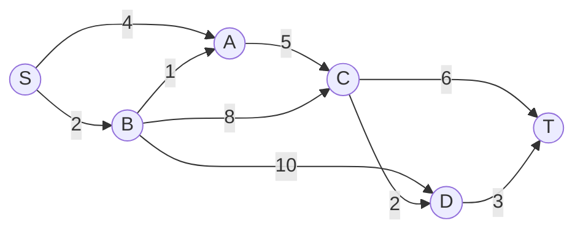
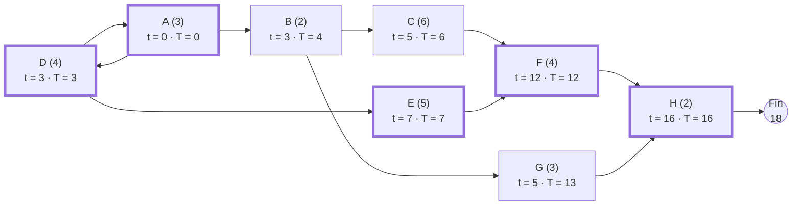

# Cours – Graphes valués, chemin optimal et ordonnancement MPM

*BTS SIO SISR 1re année – Mathématiques pour l'informatique – S17 – à lire avant les [exercices](02-exercices.md)*

> [!NOTE] Ce que tu dois savoir déjà
> - **Prérequis :** S16 (graphes, niveaux).
> - **Outils :** Papier, calculatrice, éditeur Python intégré au site

## À la fin de ce cours tu sauras

- [ ] **Définir** un graphe valué et la longueur (valeur) d'un chemin ;
- [ ] **Déterminer** un chemin de valeur minimale par une méthode donnée ;
- [ ] **Construire** le graphe d'ordonnancement MPM d'un projet à partir d'un tableau de tâches ;
- [ ] **Calculer** les dates au plus tôt et au plus tard, les marges totale, libre et certaine ;
- [ ] **Identifier** les tâches critiques et le chemin critique, et **conclure** sur la durée minimale du projet.

## I. Graphes valués et chemin de valeur minimale

Un graphe est **valué** quand chaque arc porte un nombre (sa **valeur** : coût, durée, latence, distance…). La **valeur d'un chemin** est la somme des valeurs de ses arcs.

**Exemple.** Réseau de six sites ; les valeurs sont des latences en ms.

On cherche le chemin de **valeur minimale** de \(S\) vers \(T\). Un parcours direct de tous les chemins devient vite impossible quand le graphe grandit : on utilise une **méthode** systématique.

### Méthode de Dijkstra (valeurs positives)

1. On affecte à \(S\) la valeur 0 et à tous les autres sommets la valeur \(\infty\).
2. On **fixe** le sommet non encore fixé de plus petite valeur.
3. Pour chacun de ses successeurs \(y\) non fixés, si (valeur du sommet fixé + valeur de l'arc) est **inférieure** à la valeur actuelle de \(y\), on met à jour la valeur de \(y\) et on note son prédécesseur.
4. On recommence en 2 jusqu'à fixer tous les sommets (ou \(T\)).
5. On lit le chemin à l'envers, de \(T\) vers \(S\), grâce aux prédécesseurs notés.

Déroulement (entre parenthèses : le prédécesseur provisoire ; en gras : valeur fixée) :

| Étape | Sommet fixé | S | A | B | C | D | T |
|---|---|---|---|---|---|---|---|
| 1 | **S** | **0** | 4 (S) | 2 (S) | ∞ | ∞ | ∞ |
| 2 | **B** | 0 | 3 (B) | **2** | 10 (B) | 12 (B) | ∞ |
| 3 | **A** | 0 | **3** | 2 (S) | 8 (A) | 12 (B) | ∞ |
| 4 | **C** | 0 | 3 (B) | 2 (S) | **8** | 10 (C) | 14 (C) |
| 5 | **D** | 0 | 3 (B) | 2 (S) | 8 (A) | **10** | 13 (D) |
| 6 | **T** | 0 | 3 (B) | 2 (S) | 8 (A) | 10 (C) | **13** |

Valeur minimale de \(S\) à \(T\) : **13**. Chemin (lu à l'envers grâce aux prédécesseurs) : S → B → A → C → D → T, de valeur 2 + 1 + 5 + 2 + 3 = 13. À titre de comparaison, le chemin \(S \to B \to D \to T\), qui semble plus court (3 arcs seulement), vaut 15 : **moins d'arcs ne veut pas dire moins de valeur**.

> [!WARNING]
> Dijkstra suppose des valeurs **positives ou nulles**. Avec des valeurs négatives, la méthode peut se tromper (hors programme).

Le tableau donne aussi les valeurs minimales de \(S\) vers tous les autres sommets : \(A\) : 3, \(B\) : 2, \(C\) : 8, \(D\) : 10. Ces résultats ont été recoupés avec une bibliothèque de graphes.

## II. Ordonnancement d'un projet : la méthode MPM

Un **projet** est un ensemble de **tâches** de durées connues, liées par des **contraintes d'antériorité** (une tâche ne commence qu'après la fin de certaines autres). La méthode **MPM** (méthode des potentiels Métra) répond à deux questions : **quelle est la durée minimale du projet ?** et **quelles tâches ne doivent pas prendre de retard ?**

**Exemple : déploiement d'une salle informatique.**

| Tâche | Désignation | Durée (jours) | Prédécesseurs |
|---|---|---|---|
| **A** | Audit de l'existant | 3 | — |
| **B** | Commande du matériel | 2 | A |
| **C** | Livraison du matériel | 6 | B |
| **D** | Préparation de la salle | 4 | A |
| **E** | Câblage réseau | 5 | D |
| **F** | Installation des postes | 4 | C, E |
| **G** | Configuration du serveur | 3 | B |
| **H** | Recette et formation | 2 | F, G |

### Le graphe MPM

- Chaque tâche est un **sommet** portant sa durée ;
- un arc va d'une tâche vers chacune de ses **successeurs**, valué par la **durée de la tâche de départ** ;
- on ajoute un sommet **Début** (relié aux tâches sans prédécesseur) et un sommet **Fin** (relié aux tâches sans successeur).

### Dates au plus tôt \(t\)

\(t(\text{Début}) = 0\). Une tâche ne peut commencer qu'une fois **tous** ses prédécesseurs finis :

\[
t(x) = \max_{p \in \text{prédécesseurs}} \bigl(t(p) + d(p)\bigr)
\]

(maximum sur les prédécesseurs). On parcourt le graphe **dans l'ordre des niveaux** (S16). La date de Fin donne la **durée minimale du projet**.

Ici : \(t(A) = 0\), \(t(B) = 3\), \(t(C) = 5\), \(t(D) = 3\), \(t(E) = 7\), \(t(F) = 12\), \(t(G) = 5\), \(t(H) = 16\), et \(t(\text{Fin}) = 18\) : **durée minimale du projet : 18 jours**. Par exemple \(t(F) = \max(t(C) + d(C),\ t(E) + d(E)) = \max(5 + 6,\ 7 + 5) = 12\).

### Dates au plus tard \(T\)

\(T(\text{Fin}) = t(\text{Fin})\). On remonte le graphe (sens inverse) : une tâche doit finir à temps pour **tous** ses successeurs :

\[
T(x) = \min_{s \in \text{successeurs}} T(s) \;-\; d(x)
\]

(minimum sur les successeurs ; pour une tâche sans successeur, on utilise \(T(\text{Fin})\)). Ici : \(T(A) = 0\), \(T(B) = 4\), \(T(C) = 6\), \(T(D) = 3\), \(T(E) = 7\), \(T(F) = 12\), \(T(G) = 13\), \(T(H) = 16\).

(chaque sommet : tâche, durée entre parenthèses, \(t\) et \(T\) ; encadrement épais = tâches critiques.)

### Marges

| Marge | Définition | Formule |
|---|---|---|
| **Totale** | retard maximal de la tâche **sans retarder la fin du projet** | \(M_T(x) = T(x) - t(x)\) |
| **Libre** | retard maximal **sans retarder aucune tâche suivante** (qui reste à son « au plus tôt ») | \(M_L(x) = \min_{s} t(s) - t(x) - d(x)\) |
| **Certaine** | retard possible **même si tous les prédécesseurs ont fini au plus tard** (et sans retarder les suivantes) | \(M_C(x) = \max\bigl(0,\ \min_s t(s) - \max_p (T(p) + d(p)) - d(x)\bigr)\) |

Les minimums portent sur les successeurs \(s\) (la Fin si la tâche n'en a pas) ; le maximum sur les prédécesseurs \(p\) (le Début, de date 0, s'il n'y en a pas). On a toujours \(M_C \le M_L \le M_T\).

> [!NOTE]
> **Vocabulaire.** Les noms « marge libre » et « marge certaine » sont utilisés avec des définitions voisines selon les ouvrages ; on retient celles du tableau, et un énoncé d'examen doit rappeler la définition attendue.

| Tâche | Désignation | Durée | Prédécesseurs | Au plus tôt \(t\) | Au plus tard \(T\) | Marge totale | Marge libre | Marge certaine |
|---|---|---|---|---|---|---|---|---|
| **A** | Audit de l'existant | 3 | — | 0 | 0 | 0 | 0 | 0 |
| **B** | Commande du matériel | 2 | A | 3 | 4 | 1 | 0 | 0 |
| **C** | Livraison du matériel | 6 | B | 5 | 6 | 1 | 1 | 0 |
| **D** | Préparation de la salle | 4 | A | 3 | 3 | 0 | 0 | 0 |
| **E** | Câblage réseau | 5 | D | 7 | 7 | 0 | 0 | 0 |
| **F** | Installation des postes | 4 | C, E | 12 | 12 | 0 | 0 | 0 |
| **G** | Configuration du serveur | 3 | B | 5 | 13 | 8 | 8 | 7 |
| **H** | Recette et formation | 2 | F, G | 16 | 16 | 0 | 0 | 0 |

Lecture :

- la tâche **\(G\)** (configuration du serveur) peut être retardée de 8 jours sans retarder le projet (\(M_T = 8\)) ; elle ne gêne aucune tâche suivante pendant 8 jours (\(M_L = 8\)) ; et même si la commande \(B\) n'était terminée qu'au plus tard, elle garderait 7 jours de souplesse (\(M_C = 7\)) ;
- la tâche **\(B\)** a une marge totale de 1 jour mais une marge libre nulle : la retarder retarde \(C\) et \(G\), qui commencent tout de suite après (sans toutefois retarder le projet, car \(C\) a elle-même une marge de 1).

### Tâches critiques et chemin critique

Une tâche est **critique** si sa marge totale est **nulle** : tout retard retarde le projet. Les tâches critiques forment un **chemin critique** du Début à la Fin, dont la longueur est la durée minimale du projet.

Ici : **A → D → E → F → H**, soit 3 + 4 + 5 + 4 + 2 = 18 jours. (Les durées des tâches critiques s'additionnent : c'est un contrôle.) Ce chemin est le plus long chemin du graphe, ce qui a été recoupé avec une recherche exhaustive.

## III. Interpréter et décider

- Pour **réduire** la durée du projet, il faut agir sur une tâche **critique** : accélérer \(G\) ne sert à rien.
- Si une tâche non critique dépasse sa **marge totale**, elle devient critique et retarde le projet.
- Plusieurs chemins critiques peuvent exister : il faut alors agir sur **tous** pour gagner du temps.

## À retenir

- Dijkstra : fixer à chaque étape le sommet de plus petite valeur ; mettre à jour les successeurs ; remonter par les prédécesseurs.
- MPM : \(t(x) = \max(t(p) + d(p))\), \(T(x) = \min T(s) - d(x)\), \(M_T = T - t\).
- Marge libre \(M_L = \min t(s) - t(x) - d(x)\) ; marge certaine \(M_C = \max(0, \min t(s) - \max(T(p) + d(p)) - d(x))\).
- Tâche critique : \(M_T = 0\) ; chemin critique = plus long chemin = durée du projet.
